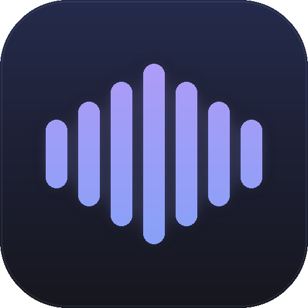

<p align="center">
  
</p>

# Renosancse Craft

[](https://github.com/Px31/renosancse-craft/actions/workflows/ci.yml)
[](https://github.com/Px31/renosancse-craft/actions/workflows/release.yml)
[](LICENSE)
[](https://www.rust-lang.org)
[](#install)

**The last audio converter you will ever need.**

Renosancse Craft detects what an audio file *actually is* (magic bytes, not just the extension), probes it with `ffprobe`, and recommends the best target format for common use-cases—then converts it. Batch queue, progress bars, metadata preservation, cross-platform native binaries.

> One converter to carry them all.

---

## Features

- **Real format detection.** Byte-signature sniffing catches mislabeled files (`.ogg` renamed to `.mp3` fails at decode time; we catch it up front).
- **Smart recommendations.** Lossless sources → FLAC archive. Lossy sources → MP3 320 kbps for universal playback. M4A → keeps quality context in the reason text.
- **Any-to-any.** MP3, M4A/AAC, WAV, FLAC, OGG/Vorbis, Opus, AIFF, ALAC, WMA, AC-3.
- **Batch queue.** Drop in dozens of files; analyze and convert them one at a time without freezing the UI.
- **Metadata preserved.** `-map_metadata 0` on every conversion.
- **Native binaries.** `.msi`/`.zip` on Windows, `.deb` on Debian/Ubuntu, `.rpm` on Fedora, `.tar.gz` portable archive.
- **Pure Rust UI.** [`iced`](https://iced.rs) renders natively via `wgpu`—no WebView, no Electron.

---

## Install

### Windows
Download the latest `renosancse-craft-vX.Y.Z-x86_64-pc-windows-msvc.zip` from [Releases](https://github.com/Px31/renosancse-craft/releases), extract, and run `renosancse-craft.exe`. Requires **FFmpeg** on `PATH` — install with [Scoop](https://scoop.sh) or [winget](https://learn.microsoft.com/windows/package-manager/):

```powershell
winget install Gyan.FFmpeg
```

### Debian / Ubuntu
```bash
sudo apt install ./renosancse-craft_*_amd64.deb
sudo apt install ffmpeg
```

### Fedora
```bash
sudo dnf install ./renosancse-craft-*.x86_64.rpm ffmpeg
```

### From source
```bash
git clone https://github.com/Px31/renosancse-craft.git
cd renosancse-craft
cargo run --release
```

Build prerequisites per platform are in [CONTRIBUTING.md](CONTRIBUTING.md#build-prerequisites).

---

## How it works

```
  ┌──────────────┐   ┌──────────────┐   ┌──────────────┐   ┌──────────────┐
  │ detect.rs    │ → │ probe.rs     │   │ recommend.rs │ → │ convert.rs   │
  │ magic bytes  │   │ ffprobe JSON │   │ rules engine │   │ ffmpeg spawn │
  └──────────────┘   └──────────────┘   └──────────────┘   └──────────────┘
```

- **Detection** reads the first 12 bytes and matches RIFF/WAVE, fLaC, OggS, ID3, MP4 `ftyp`, ADTS AAC, AIFF, ASF, AC-3 signatures.
- **Probing** runs `ffprobe -show_format -print_format json` to get the real container, duration, and bitrate.
- **Recommendation** is a plain-Rust rules engine: lossless → FLAC; lossy → MP3 320 kbps; ambiguous → WAV.
- **Conversion** builds an `ffmpeg` command with the right codec (`libmp3lame`, `aac`, `flac`, `libopus`, …) and runs it on a blocking thread.

See [src/audio/](src/audio/) for the full pipeline.

---

## Why FFmpeg?

Pure-Rust codec stacks like Symphonia + Rubato are elegant, but HE-AAC is marked *incomplete*, AC-3 isn't supported, and the container coverage gap would surface the first time someone drops an `.ac3` or `.wma` file. Renosancse Craft uses FFmpeg as a sidecar so the codec matrix is effectively "everything". The Rust layer stays responsible for routing, validation, and metadata, and the `Converter` seam is designed so a pure-Rust fallback engine can be plugged in later for WAV ↔ FLAC conversions.

**Licensing note:** FFmpeg is LGPL/GPL depending on build flags. It is *not* bundled — the app locates it on `PATH` and shows a friendly install prompt if missing. This keeps Renosancse Craft MIT-clean and lets users swap in their own FFmpeg build.

---

## Roadmap

- [ ] Async analysis pipeline (currently synchronous inside `analyze()`)
- [ ] Real-time progress bars parsed from `ffmpeg -progress pipe:1`
- [ ] Batch presets ("Archive everything to FLAC", "iPhone-compatible M4A/AAC")
- [ ] Pure-Rust fallback converter for lossless-only conversions
- [ ] First-run FFmpeg helper (download static build on Windows/macOS)
- [ ] macOS `.app` bundle + notarization

---

## Contributing

See [CONTRIBUTING.md](CONTRIBUTING.md). Issues and PRs welcome. This project follows the [Contributor Covenant](CODE_OF_CONDUCT.md).

## Security

See [SECURITY.md](SECURITY.md) for the disclosure process.

## License

MIT — see [LICENSE](LICENSE). FFmpeg is distributed under its own license; you are responsible for how you install and redistribute it.
